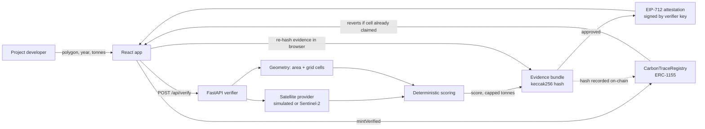

# Architecture

## Components

**Registry contract (`CarbonTraceRegistry.sol`)** is an ERC-1155 where token id is the project and one unit is one tonne of CO2e.
It accepts a mint only with a valid EIP-712 attestation from an address holding `VERIFIER_ROLE`. It stores, per vintage year,
which project holds each land cell, and refuses any claim that touches a cell already held by an active project. It supports
retirement (burn with beneficiary and reason), revocation (freeze and release land), pause, and verifier rotation.
It also enforces its own minimum score (70/100), so a careless verifier key cannot mint junk.

**Verifier API (`backend/app`)**
- `geo.py` validates the polygon, computes hectares, and rasterises it into a 0.002 degree grid (about 220 m). Cell id = `latIdx << 32 | lonIdx`.
- `satellite.py` returns 12 monthly NDVI observations. The simulated provider is deterministic per polygon and year. The live provider reads Sentinel-2 L2A COGs through the Element84 STAC API and masks clouds with the scene classification band.
- `scoring.py` is a pure function: vegetation (50%), stability against clearing (20%), claim plausibility (20%), evidence confidence (10%), then hard caps (non-forest land, thin canopy, clearing, claims above 3x capacity, low-confidence data).
  Verified tonnes are `min(claimed, area x rate x canopy)`.
- `attest.py` signs the attestation. `evidence.py` stores the canonical JSON bundle and serves the exact bytes.
- `explain.py` writes the plain-language reason. With `ANTHROPIC_API_KEY` set, Claude rewrites it. The model never sees the decision as an open question and cannot change it.

**Frontend (`frontend`)** reads the API and talks to the chain through ethers. Demo wallets exist only on the local chain (31337).

## Design decisions

- **AI as an oracle, not an authority.** The decision is a transparent formula over published evidence. Anyone can re-run it.
- **Two independent gates.** The verifier checks the physical claim. The contract checks uniqueness. Neither trusts the other for its own job.
- **Cells, not polygons, on-chain.** Exact polygon intersection is too expensive in the EVM. A fixed grid gives cheap, exact set membership and is conservative: a cell is claimed if the polygon covers at least 20% of it.
- **Evidence is hash-committed.** Changing a single byte of a report breaks the on-chain match, and the app shows that to the user.
- **Revocation releases land.** A fraudulent project must not permanently block the honest owner of that land.

## Attestation format

EIP-712 domain `CarbonTraceRegistry` v1. Struct `Attestation(address to, uint16 vintage, int32 centroidLatE6, int32 centroidLonE6, bytes32 cellsHash, uint256 tonnes, uint16 scoreBps, bytes32 evidenceHash, bytes32 metadataHash, uint256 deadline, uint256 nonce)`.
`cellsHash = keccak256(abi.encodePacked(uint64[]))` (each element padded to 32 bytes). Cells must be strictly ascending.
